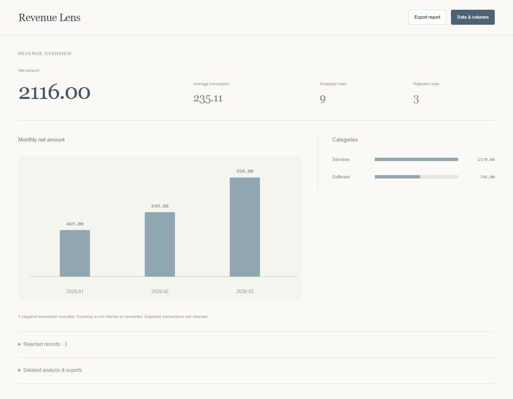

# Revenue Lens

Reconcile sales and refunds, explore monthly/category trends, and export rejected records.



## Run

Requires Python 3.11+; no third-party runtime dependencies. Clone this repository and run from its root:

```sh
python run.py
```

Open http://127.0.0.1:8000/. Use `python run.py --port 8001` to run alongside another app.
The app initially displays a report from its fictional sample. Open **Data & columns** to replace the CSV or change column mappings.

The local adapter creates an empty `data/revenue-lens.db`; this analysis app has no persistent tables. The data directory is ignored by Git. `--database /path/to/app.db` selects another database. Uploaded analysis input is processed in memory. No other repository or shared service is required.

## Interface

The report leads with the net amount and a monthly column chart, with category totals beside it. Positive and negative totals use opposite sides of a shared zero baseline; chart pages preserve the scale across all groups. CSV input and column mappings open separately. Rejected records and detailed analysis remain available below the report, including export controls. Monthly charts scroll within their panel on narrow screens.

## API example

`examples/request.json` contains a fictional request body and its endpoint. Browser analysis requests use `Content-Type: application/json` and `X-Portfolio-Client: browser`; Notes requests use `X-API-Key`. All routes are local to this app.

## Architecture

The browser uses plain JavaScript and CSS, a loopback Python HTTP server validates requests, and domain functions produce the reports or transactional writes. `portfolio/` is the retained internal Python package name; this repository serves only **Revenue Lens**. Its database contains only this app's tables. Shared validation, CSV helpers, and visual utilities have local copies, so changes can be released independently.

## Verify

```sh
python -m unittest discover -s tests -v
python check_js.py
node --test
```

Node.js 22+ is used for frontend checks only. GitHub Actions tests Linux on Python 3.11–3.13 and Windows on Python 3.13.

## Scope

Designed as a local portfolio/demo application. The standard-library server is not a production internet deployment. There is no multi-user authentication or tenant isolation.

## Source provenance

Extracted from [Portfolio Lab](https://github.com/Michaelhoang8/portfolio-lab) at commit `ce14f2cf297c6dfbd5895b9138626b7e69530ec0`. The original repository retains the genuine development history. This repository begins with the standalone extraction; history has not been backdated. Runtime databases and credentials were not copied.
